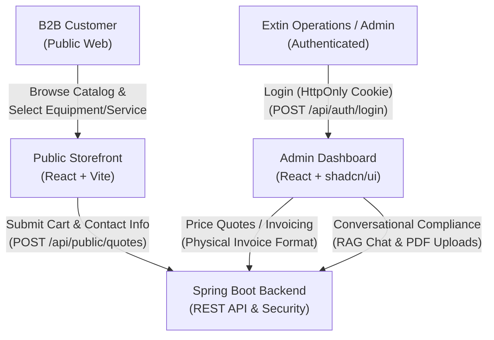
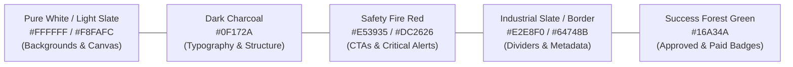
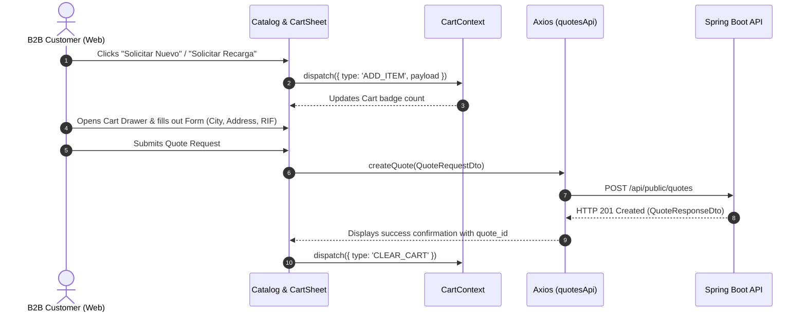
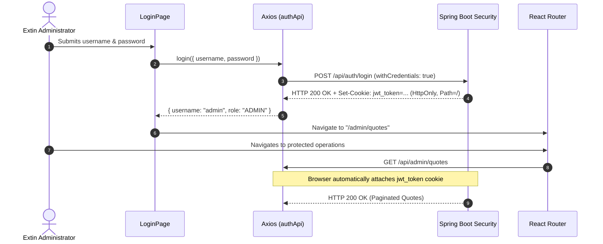
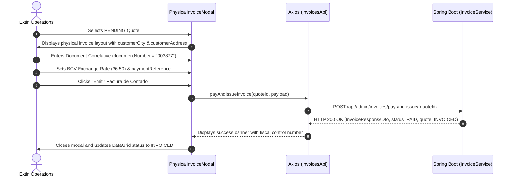

# Frontend Specification: Extin ERP & B2B Web Portal

**Document Version:** 1.0.0  
**Status:** Approved Architecture Specification  
**Target Application:** Extin B2B Public Store & Admin Operations Dashboard  
**Methodology:** Specification-Driven Development (SDD)  

---

## 1. Executive Summary & Product Vision

**Extin ERP** is an integrated fire safety and industrial protection platform designed for commercial businesses, industrial plants, and safety compliance managers. The web client serves two distinct user profiles with tailored interfaces:

1. **Public B2B Store (Landing Page & Catalog):** A clean, corporate, and high-trust public-facing web portal where prospective and existing corporate clients can explore fire safety equipment and recharge services, configure a quote cart, and request quotations without public price exposure.
2. **Private Administrative Dashboard (Admin Portal):** A secure, authenticated workspace for Extin sales managers and compliance engineers to review incoming quote requests, price line items using the official BCV (Banco Central de Venezuela) exchange rate, print/record physical invoice book numbers (*talonarios correlativos*), issue fiscal invoices, and query regulatory compliance via a conversational RAG AI assistant.



---

## 2. Technology Stack & Client Architecture

The frontend application is constructed as a modern Single Page Application (SPA) prioritizing performance, corporate aesthetics, and strict security posture.

| Tier / Concern | Selected Technology | Technical Rationale & Configuration |
|---|---|---|
| **Build Tool & Runtime** | **Vite + React 18+ (TypeScript)** | Ultra-fast Hot Module Replacement (HMR), optimized production tree-shaking, strict type safety across API DTO models. |
| **Styling Framework** | **Tailwind CSS v3+** | Utility-first CSS providing predictable design tokens, mobile-first responsive utilities, and seamless dark/light mode primitives. |
| **Component System** | **shadcn/ui (Radix UI Primitives)** | Accessible, unstyled, composable UI primitives (Dialogs, Sheets, Dropdowns, Tables, Badges) owned in-codebase without runtime overhead. |
| **Client-Side Routing** | **React Router DOM v6+** | Declarative nested routing, layout routes, and role-guarded route boundaries (`<ProtectedRoute role="ADMIN" />`). |
| **HTTP & Networking** | **Axios (Configured Instance)** | Pre-configured client with `withCredentials: true` to seamlessly transmit `HttpOnly` JWT session cookies (`jwt_token`) and handle standardized `ErrorResponseDto` exceptions. |
| **Icons & Assets** | **Lucide React** | Clean, minimalist, and standardized SVG icons representing equipment, security seals, shopping carts, and navigation nodes. |
| **Forms & Validation** | **React Hook Form + Zod** | High-performance uncontrolled form state management with strict schema validation for phone numbers, fiscal IDs (RIF/CNPJ), and physical addresses. |
| **State Management** | **React Context + LocalStorage** | Lightweight global state for the shopping cart (`CartContext`) with client-side persistence, and authentication status (`AuthContext`). |
| **Internationalization (i18n)** | **i18next + react-i18next + i18next-browser-languagedetector** | Complete multi-language localization supporting Spanish (ES), English (EN), and Portuguese (PT) across both Public Storefront and Admin Dashboard modules. Includes automatic browser language detection, persistent selection, and fallback to Spanish (ES). |

---

## 3. Design System & Visual Guidelines

### 3.1. Brand Identity & High-Trust Corporate Aesthetics
Fire safety and industrial protection require an aesthetic that inspires **authority, technical competence, and absolute reliability**:
* **Visual Atmosphere:** Clean corporate minimalism, generous whitespace, sharp typography, structured borders, and purposeful contrast.
* **Price Concealment Policy:** Because industrial equipment and recharge services depend on corporate volume, technical certifications, and volatile multi-currency rates, **prices are strictly hidden from the public store**. The customer’s primary action is to *request a quote*, fostering direct B2B lead generation.

### 3.2. Color Tokens & Theme Definition



* **Canvas & Surfaces:**
  * Background Default: `#FFFFFF` (Pure White) and `#F8FAFC` (Slate 50 for page backgrounds and subtle surface elevation).
  * Card Surfaces: `#FFFFFF` with border `#E2E8F0` (Slate 200) and soft shadow `shadow-sm`.
* **Typography:**
  * Primary Text: `#0F172A` (Slate 900) for headers and high-contrast readability.
  * Secondary Text: `#475569` (Slate 600) for descriptions, specs, and form hints.
  * Muted Text: `#94A3B8` (Slate 400) for placeholders and timestamps.
* **Accent & Actions (Safety Red):**
  * Primary Brand / Safety Red: `#E53935` (Tailwind `red-600` / `#DC2626`).
  * Hover / Active Red: `#B71C1C` (Tailwind `red-700` / `red-800`).
  * Subtle Red Tint: `#FEF2F2` (Tailwind `red-50`) for alert banners and active cart indicators.
* **System Status Colors:**
  * `PENDING`: Warning Amber (`bg-amber-100 text-amber-800 border-amber-300`).
  * `APPROVED` / `PRICED`: Info Blue (`bg-blue-100 text-blue-800 border-blue-300`).
  * `INVOICED` / `PAID`: Success Green (`bg-emerald-100 text-emerald-800 border-emerald-300`).
  * `REJECTED`: Danger Red (`bg-rose-100 text-rose-800 border-rose-300`).

---

## 4. Visual Structure: Landing Page (Public Store)

The public storefront acts as the official digital showcase for Extin's certified fire extinguishers, suppression accessories, and certified recharge services.

```
+---------------------------------------------------------------------------------------------------+
|  [LOGO] EXTIN ERP    Inicio    Catálogo    Servicios    Normativas NFPA    Contacto    [CART (3)] |
+---------------------------------------------------------------------------------------------------+
|                                                                                                   |
|   HERO: Equipamiento Contra Incendio Certificado y Recargas Industriales                         |
|   Normativas NFPA 10 & COVENIN | Asesoría Técnica Inmediata                                      |
|   [ Explorar Catálogo ]   [ Solicitar Inspección ]                                                |
|                                                                                                   |
+---------------------------------------------------------------------------------------------------+
|  FILTROS:  [ Todos ]  [ Polvo Químico PQS ]  [ Dióxido de Carbono CO2 ]  [ Solkaflam ]  [ Agua ]  |
+---------------------------------------------------------------------------------------------------+
|  CATÁLOGO GRID:                                                                                   |
|  +------------------------+  +------------------------+  +------------------------+               |
|  | [ IMAGEN EXTINTOR ]    |  | [ IMAGEN EXTINTOR ]    |  | [ IMAGEN EXTINTOR ]    |               |
|  | Extintor PQS 10 Lbs    |  | Extintor CO2 15 Lbs    |  | Solkaflam 10 Lbs       |               |
|  | Tipo: Polvo Seco ABC   |  | Tipo: Dióxido Carbono  |  | Tipo: Agente Limpio    |               |
|  | Capacidad: 10 Libras   |  | Capacidad: 15 Libras   |  | Capacidad: 10 Libras   |               |
|  | Precios corporativos   |  | Precios corporativos   |  | Precios corporativos   |               |
|  | [ Solicitar Nuevo ]    |  | [ Solicitar Nuevo ]    |  | [ Solicitar Nuevo ]    |               |
|  | [ Solicitar Recarga ]  |  | [ Solicitar Recarga ]  |  | [ Solicitar Recarga ]  |               |
|  +------------------------+  +------------------------+  +------------------------+               |
+---------------------------------------------------------------------------------------------------+
```

### 4.1. Global Navbar
* **Brand Identity:** High-resolution Extin corporate SVG logo linking to home (`/`).
* **Navigation Links:**
  * `Catálogo` (smooth scroll to catalog grid).
  * `Servicios` (maintenance, hydrostatic testing, technical inspection).
  * `Normativas` (NFPA 10 & COVENIN compliance information).
  * `Contacto` (direct office telephone and WhatsApp contact link).
* **Quote Cart Widget:**
  * Fixed right-side shopping cart icon (`ShoppingCart` from Lucide).
  * Dynamic counter badge showing total items in the quote request.
  * Clicking the icon triggers the **Quote Checkout Offcanvas Drawer**.
* **Access Link:** Discreet "Acceso Administrativo" link in the header/footer navigating to `/admin/login`.

### 4.2. Hero Section
* **Headline:** "Seguridad y Protección Contra Incendios para la Industria y el Comercio".
* **Sub-headline:** "Extintores nuevos certificados bajo norma NFPA 10 y servicio técnico especializado de recarga y mantenimiento con certificación oficial de operatividad".
* **Value Pillars:** Badges highlighting "Certificación COVENIN", "Taller Autorizado", "Despacho Inmediato", and "Facturación Formal de Contado".

### 4.3. Responsive Catalog Grid & Product Cards
* **Category Filters:** Quick filter chips (Todos, PQS, CO2, Agua Presurizada, Solkaflam, Mangueras y Gabinetes).
* **Search Field:** Real-time text search filtering items by name, SKU, or agent type.
* **Product Card Specifications:**
  * **Visual Container:** White rounded card with border (`border-slate-200 shadow-sm hover:shadow-md transition-shadow`).
  * **Product Image:** Centered container with fixed aspect ratio (`aspect-square`), high-contrast transparent PNG of the extinguisher cylinder.
  * **Specification Tags:** Badges for Class (e.g., `Clase ABC`, `Clase BC`), Capacity (`10 Lbs`, `20 Lbs`, `2.5 Gal`), and SKU Code (`EXT-PQS-10`).
  * **Descriptive Copy:** Brief technical description highlighting usage application (e.g., "Apto para depósitos, oficinas y vehículos de carga").
  * **Strict Price Concealment Notice:** A subtle, professional indicator: *"Cotización por volumen y recargas a solicitud"*.
  * **Dual Action Buttons (CTAs):**
    * **"Solicitar Equipo Nuevo" (Primary Action):** Red button (`bg-red-600 hover:bg-red-700 text-white`) adding the item to the cart with type `PRODUCT`.
    * **"Solicitar Recarga" (Secondary Action):** Outline button (`border border-slate-300 hover:border-red-600 hover:text-red-600 text-slate-700`) adding the corresponding refill service to the cart with type `SERVICE`.

### 4.4. Quote Checkout Drawer (Offcanvas Panel)
When the user clicks the Cart icon or adds an item, an offcanvas Sheet (`shadcn/ui Sheet`) slides in from the right:
* **Section 1: Line Items Review:**
  * List of selected products and recharge requests.
  * Line item controls: Increment (`+`), Decrement (`-`), Delete (`Trash2`).
  * Clear visual badges differentiating `[EQUIPO NUEVO]` vs `[SERVICIO DE RECARGA]`.
* **Section 2: Customer Contact & Dispatch Form:**
  * **Tax ID / Fiscal ID (`tax_id`):** Text input with mask validation (e.g., `J-12345678-9` or `V-14567890-1`).
  * **Business Name / Contact Name (`business_name`):** Full corporate name or customer name.
  * **Phone Number (`phone`):** Primary phone number for dispatch coordination and pricing follow-up.
  * **Email (`email`):** Required for delivering quote confirmations and PDF vouchers.
  * **City (`customer_city`):** Dropdown / text input (e.g., Caracas, Valencia, Maracay, Barquisimeto).
  * **Delivery Address (`customer_address`):** Detailed street, building, and industrial zone address for dispatch calculation.
  * **Target Currency Selector (`target_currency`):** Selection between `USD` (Base Reference), `VES` (Bolívares / BCV), or `BRL` (Reales Brasileños).
* **Section 3: Submission Action:**
  * "Enviar Solicitud de Cotización" button.
  * Submits payload to backend endpoint `POST /api/public/quotes`.
  * Renders a success confirmation modal displaying the generated `quote_id`, informing the customer that an Extin technical representative has received their request.

---

## 5. Visual Structure: Admin Dashboard (Private Workspace)

The administrative panel is a high-productivity, desktop-optimized web workspace for managing orders, pricing quotes against physical invoice books, and regulatory analysis.

```
+---------------------------------------------------------------------------------------------------+
| [EXTIN ERP ADMIN]  | Buscar cotización, cliente, RIF...      |  Admin Extin  [Rol: ADMIN]  [Salir] |
+--------------------+------------------------------------------------------------------------------+
| SIDEBAR            | MAIN CONTENT AREA: Módulo de Cotizaciones Pendientes                          |
|                    |                                                                              |
|  [icon] Cotizaciones|  +-----------------------------------------------------------------------+   |
|  [icon] Facturas   |  | ID       | Fecha      | Cliente / RIF         | Ciudad  | Estado  | Acción|   |
|  [icon] Clientes   |  |----------+------------+-----------------------+---------+---------+-------|   |
|  [icon] Catálogo   |  | #a1b2c3  | 21/10/2026 | Inversiones El Sol    | Caracas | PENDING | [Ver] |   |
|  [icon] Asistente  |  | #b2c3d4  | 21/10/2026 | Metalúrgica Paulistana| S. Paulo| PENDING | [Ver] |   |
|         IA (RAG)   |  | #c3d4e5  | 20/10/2026 | Alimentos Los Andes   | Mérida  | INVOICED| [Ver] |   |
|  [icon] Manuales   |  +-----------------------------------------------------------------------+   |
|         PDF (Docs) |                                                                              |
+--------------------+------------------------------------------------------------------------------+
```

### 5.1. Authentication Screen (`/admin/login`)
* **Route:** `/admin/login`.
* **Visual Presentation:** Centered corporate card with company seal and dark background (`bg-slate-900`).
* **Fields:** Username and Password.
* **Mechanism:** Submits to `POST /api/auth/login`. On HTTP 200, the backend sets the secure `jwt_token` `HttpOnly` cookie. The frontend stores user metadata in `AuthContext` and redirects to `/admin/quotes`.

### 5.2. Admin Layout Shell
* **Fixed Left Sidebar (260px):**
  * Brand Header: "Extin ERP — Industrial Operations".
  * Navigation Links with active indicators:
    * `Cotizaciones` (`/admin/quotes`) — Primary queue.
    * `Facturas Emitidas` (`/admin/invoices`) — Ledger of paid invoices.
    * `Directorio de Clientes` (`/admin/customers`) — Searchable CRM and equipment registry.
    * `Inventario & Catálogo` (`/admin/catalog`) — Product SKU and base prices.
    * `Asistente Técnico IA (RAG)` (`/admin/rag`) — Chatbot for NFPA/COVENIN standard queries.
    * `Gestión de Manuales PDF` (`/admin/documents`) — Document upload & vector store status.
* **Global Topbar:**
  * Breadcrumb navigation (e.g., `Operaciones / Cotizaciones / Detalle`).
  * Global search bar querying quotes by ID, customer name, or RIF.
  * Current BCV Reference Rate ticker (e.g., `Tasa BCV: 36.50 VES/USD`).
  * User profile dropdown with role badge (`ADMIN`) and "Cerrar Sesión" (`POST /api/auth/logout`).

---

### 5.3. Quotes Management & Physical Invoice Replication View

The centerpiece of the operations panel is the **Physical Invoice Replication Modal / Screen**, designed to match the physical order and receipt books (*talonarios de facturación física*) traditionally used in Extin's workshops and front desk.

```
+---------------------------------------------------------------------------------------------------+
| DETALLE DE COTIZACIÓN / FACTURA FÍSICA DE CONTADO                                     [ CERRAR X ] |
+---------------------------------------------------------------------------------------------------+
|  EXTIN, C.A. - SEGURIDAD INDUSTRIAL                       N° TALONARIO: [  003877  ] (Editable)   |
|  RIF: J-00000000-0 | Tlf: (0212) 555-0199                 FECHA EMISIÓN: 21/10/2026 10:30 AM      |
+---------------------------------------------------------------------------------------------------+
|  CLIENTE: Inversiones El Sol, C.A.                        RIF/CI: J-12345678-9                    |
|  CIUDAD:  Caracas                                         TELÉFONO: +58 212-951-1234              |
|  DIRECCIÓN FISCAL: Av. Francisco de Miranda, Torre Delta, Piso 4, Caracas                         |
+---------------------------------------------------------------------------------------------------+
|  RENGLONES DEL PEDIDO:                                                                            |
|  Cant | Código SKU  | Descripción del Producto / Servicio      | P. Unit (USD) | Subtotal (USD)   |
|  -----+-------------+------------------------------------------+---------------+----------------- |
|   2   | EXT-PQS-10  | Extintor Polvo Químico Seco 10 Lbs ABC   | [ $38.50 ]    | $77.00           |
|   1   | REC-CO2-5   | Servicio Recarga Dióxido Carbono 5 Lbs   | [ $15.00 ]    | $15.00           |
+---------------------------------------------------------------------------------------------------+
|  PARÁMETROS DE FACTURACIÓN:                                LIQUIDACIÓN TOTAL:                     |
|  Moneda Destino:     [ VES (Bolívares) v ]                 Total Base USD:          $ 92.00       |
|  Tasa de Cambio BCV: [ 36.5000 ] VES/USD                   I.V.A. Estimado (16%):   $ 14.72       |
|  Referencia de Pago: [ 0102-000987654321 ]                 TOTAL GENERAL (USD):     $ 106.72      |
|  Condición de Pago:  [ Contado / Pago Móvil ]              TOTAL FACTURA (VES):   Bs 3,895.28     |
+---------------------------------------------------------------------------------------------------+
|  [ Guardar Borrador ]   [ Aprobar Cotización ]   [ Emitir Factura de Contado (INVOICED) ]         |
+---------------------------------------------------------------------------------------------------+
```

#### Workflow & Interaction Logic:
1. **Queue Inspection (`DataGrid`):**
   * Displays all customer requests submitted via the web with status `PENDING`.
   * Columns: `Quote ID`, `Fecha`, `Cliente`, `RIF`, `Ciudad`, `Items`, `Estado`.
2. **Opening Physical Voucher View:**
   * Clicking any row opens the detailed physical invoice replica.
3. **Data Population & In-Place Editing:**
   * **Customer & Dispatch Section:** Pre-populated with `customerCity` and `customerAddress` from the web form. Admin can modify address or city if the customer provides delivery corrections.
   * **Talonario Correlative Number (`documentNumber`):** Dedicated input for the administrative assistant to transcribe the printed paper invoice number (e.g., `003877`).
   * **Line-Item Unit Prices:** Displays the default catalog prices in USD with editable inputs allowing manual commercial adjustments or volume discounts.
   * **Exchange Rate Engine:** Admin inputs or confirms the official BCV exchange rate (e.g., `36.50`). The system dynamically calculates `total_amount_local` (`USD * rate`) in real time.
4. **Lifecycle Transition Buttons:**
   * **"Aprobar Cotización" (`APPROVED`):** Locks the price and generates a quotation PDF for client approval.
   * **"Emitir Factura de Contado" (`INVOICED`):** Finalizes the quote as a settled cash invoice. Automatically sends the payload to `POST /api/admin/invoices/pay-and-issue/{quote_id}` with `exchange_rate` and `payment_reference`, marking the transaction as `PAID` and `INVOICED`.

---

### 5.4. Conversational RAG Module (Regulatory AI Assistant)

The AI module allows compliance inspectors and sales managers to consult uploaded technical standards (NFPA 10, COVENIN regulations, safety sheets) through an intuitive ChatGPT-style chat interface.

```
+---------------------------------------------------------------------------------------------------+
| ASISTENTE DE NORMATIVAS Y SEGURIDAD INDUSTRIAL (SPRING AI + OLLAMA)                               |
+---------------------------------------------------------------------------------------------------+
| DOCUMENTOS CARGADOS:                                | CONVERSACIÓN (SESIÓN: #chat-ops-01)          |
|  - NFPA 10: Extintores Portátiles (18 chunks)       |                                             |
|  - COVENIN 1040: Terminología y Criterios           | [Usuario]                                    |
|                                                     | ¿A qué altura máxima debe colocarse un       |
| [ + Subir Nuevo Manual PDF ]                        | extintor de 10 lbs según la norma?           |
| (Dropzone para archivos .pdf)                       |                                             |
| Categoría: [ NFPA10 v ]                             | [Asistente Extin IA]                         |
| [ Procesar y Vectorizar ]                           | Según la norma NFPA 10 (Sección 6.1.3.8):    |
|                                                     | Para extintores con peso menor a 40 lbs      |
| HISTORIAL DE CONVERSACIONES:                        | (18.14 kg), la parte superior no debe estar  |
|  - Consulta Extintores Servidores (Hoy)             | a más de 1.5 metros (5 pies) del piso.       |
|  - Vencimientos de Octubre (Ayer)                   | Herramientas Usadas: [searchInManuals(NFPA10)]|
|                                                     |                                             |
|                                                     | [ Escriba su consulta sobre extintores... ]  |
+---------------------------------------------------------------------------------------------------+
```

#### Key Capabilities:
* **Chat Stream Window:** Displays messages formatted with markdown syntax highlighting, bold headers, and bullet points.
* **Tool Calling Indicators:** Shows transparency tags whenever the AI invokes MCP backend tools (`searchInManuals`, `getSemanticCatalog`, `getCustomerHistory`).
* **Document Uploader Widget:**
  * File picker and drag-and-drop zone accepting `.pdf` technical manuals.
  * Mandatory category selector dropdown (`NFPA10`, `COVENIN`, `SAFETY`, `GENERAL`).
  * Submits as `multipart/form-data` to `POST /api/admin/documents/upload`.
  * Displays real-time progress, purge notification of previous vectors, and chunk creation summary.

---

## 6. Directory Structure & Component Hierarchy

The codebase follows a modular, feature-based architectural pattern:

```
frontend-extin/
├── public/
│   ├── favicon.ico
│   └── assets/                     # Corporate logos, product photos, badges
├── src/
│   ├── api/
│   │   ├── apiClient.ts            # Axios instance (withCredentials: true, baseURL)
│   │   ├── authApi.ts              # /api/auth/login, /api/auth/logout
│   │   ├── catalogApi.ts           # /api/public/catalog
│   │   ├── quotesApi.ts            # /api/public/quotes, /api/admin/quotes
│   │   ├── invoicesApi.ts          # /api/admin/invoices/pay-and-issue
│   │   └── ragApi.ts               # /api/admin/chat/mcp, /api/admin/documents/upload
│   ├── components/
│   │   ├── common/                 # Buttons, Badges, Loaders, ErrorAlerts
│   │   ├── layout/
│   │   │   ├── PublicNavbar.tsx    # Storefront Header with Cart badge
│   │   │   ├── PublicFooter.tsx    # Corporate footer and legal mentions
│   │   │   ├── AdminSidebar.tsx    # Fixed operations navigation
│   │   │   └── AdminTopbar.tsx     # Breadcrumbs, BCV ticker, user badge
│   │   ├── store/
│   │   │   ├── HeroSection.tsx     # Landing value proposition
│   │   │   ├── ProductCard.tsx     # Extinguisher card with dual CTA
│   │   │   ├── CatalogGrid.tsx     # Filterable list of equipment/services
│   │   │   └── CartSheet.tsx       # Offcanvas checkout form & summary
│   │   ├── admin/
│   │   │   ├── QuotesTable.tsx     # DataGrid of PENDING requests
│   │   │   ├── PhysicalInvoiceModal.tsx # Exact physical invoice layout
│   │   │   ├── RagChatWindow.tsx   # Conversational message stream
│   │   │   └── DocumentUploadCard.tsx   # PDF dropzone with category tag
│   │   └── ui/                     # shadcn/ui primitives (dialog, sheet, table, etc.)
│   ├── contexts/
│   │   ├── AuthContext.tsx         # User profile, role, isAuthenticated
│   │   └── CartContext.tsx         # Cart items, add, remove, clear, localStorage
│   ├── hooks/
│   │   ├── useAuth.ts              # Authentication hook
│   │   ├── useCart.ts              # Cart dispatcher hook
│   │   └── useCurrency.ts          # Exchange rate converter helper
│   ├── layouts/
│   │   ├── PublicLayout.tsx        # Navbar + Content + Footer
│   │   └── AdminLayout.tsx         # Sidebar + Topbar + Content (<Outlet />)
│   ├── pages/
│   │   ├── public/
│   │   │   ├── HomePage.tsx        # Main public landing & store
│   │   │   └── QuoteConfirmationPage.tsx
│   │   └── admin/
│   │       ├── LoginPage.tsx       # Admin authentication
│   │       ├── QuotesPage.tsx      # Queue and invoice management
│   │       ├── InvoicesPage.tsx    # Ledger of paid fiscal invoices
│   │       ├── RagAssistantPage.tsx# AI Chat and PDF management
│   │       └── CustomersPage.tsx   # Client database
│   ├── routes/
│   │   ├── AppRoutes.tsx           # React Router router definition
│   │   └── ProtectedRoute.tsx      # Role-based route guard
│   ├── types/
│   │   ├── api.types.ts            # ErrorResponseDto, API envelopes
│   │   ├── catalog.types.ts        # CatalogItem, ItemType
│   │   ├── quote.types.ts          # QuoteRequestDto, QuoteResponseDto
│   │   └── user.types.ts           # User, Role (ADMIN, USER)
│   ├── App.tsx
│   ├── main.tsx
│   └── index.css                   # Tailwind imports & CSS variable tokens
├── index.html
├── package.json
├── tailwind.config.js
├── tsconfig.json
└── vite.config.ts
```

---

## 7. State Management & API Integration Workflows

### 7.1. Public Quote Submission Flow



### 7.2. Admin Authentication & Session Management Flow



### 7.3. Physical Invoice Pricing & Issuance Flow



---

## 8. Security, Cross-Origin (CORS), & Error Handling

### 8.1. HttpOnly Cookie Security & CORS Alignment
1. **XSS Protection:** The frontend client **never** reads, stores, or extracts the JWT token from `localStorage` or `sessionStorage`. All authentication state relies strictly on the server-set `jwt_token` cookie marked `HttpOnly` and `SameSite=Lax`.
2. **CORS Configuration:**
   * All Axios requests configure `axios.defaults.withCredentials = true`.
   * The Spring Boot backend explicitly allows the frontend origin (e.g. `http://localhost:5173` in development) with `.allowCredentials(true)`.

### 8.2. Centralized Error Handling (`ErrorResponseDto`)
The Axios interceptor parses all HTTP error codes according to the backend's standardized exception format:

```typescript
export interface ErrorResponseDto {
  timestamp: string;
  status: number;
  error: string;
  message: string;
  path: string;
}
```

* **HTTP 401 Unauthorized:** Automatically clears `AuthContext` and redirects the user to `/admin/login?sessionExpired=true`.
* **HTTP 403 Forbidden:** Renders a notification indicating insufficient administrative privileges without crashing the SPA.
* **HTTP 400 Bad Request / 404 Not Found:** Renders field-level validation errors or toast notifications using the backend `message` string.
* **HTTP 500 Internal Server Error:** Renders a user-safe message (*"Ha ocurrido un error inesperado. Por favor contacte al administrador."*) knowing that database credentials and SQL errors are already masked at the server level.

---

## 9. Next Steps for Implementation

1. **Scaffold Vite Project:** Initialize React + TypeScript template in `frontend-extin/`.
2. **Configure Tailwind & shadcn/ui:** Set up CSS variables, theme tokens, and add essential shadcn primitives (`Button`, `Card`, `Sheet`, `Dialog`, `Input`, `Badge`, `Table`).
3. **Setup Networking:** Implement `src/api/apiClient.ts` configured with `withCredentials: true` and backend port `8090`.
4. **Build Public Storefront:** Assemble `PublicNavbar`, `CatalogGrid`, and `CartSheet` connected to live `/api/public/catalog` and `/api/public/quotes`.
5. **Build Admin Portal:** Assemble `AdminLayout`, `QuotesTable`, `PhysicalInvoiceModal`, and `RagChatWindow`.
